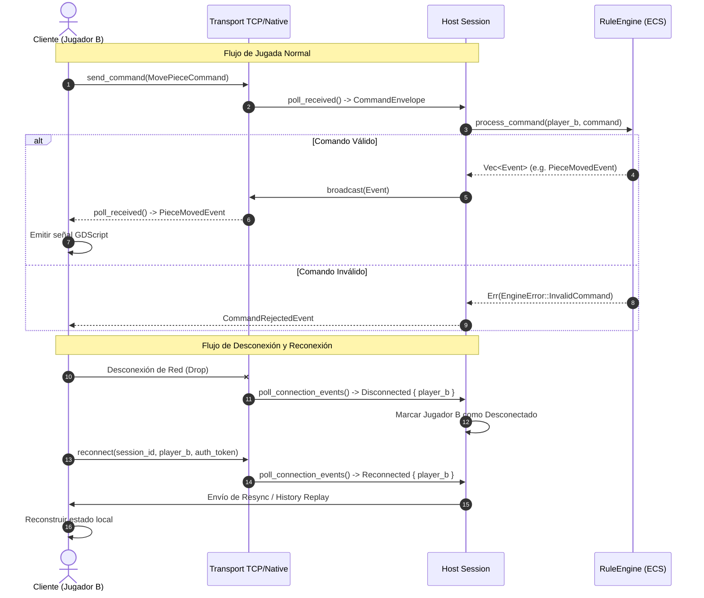

# Arquitectura — OpenTable SDK

Documento de referencia de cómo está armado el SDK y cómo se integran
sus piezas. Para pasos de setup y la lista de prioridades de lo que
falta, ver [`NEXT_STEPS.md`](./NEXT_STEPS.md).

## Principio de diseño

**Cada capa solo conoce a la que tiene debajo.** `Session` no sabe si el
`Transport` es TCP o Nearby Connections. Un juego no sabe que existe
Godot. El bridge de Godot no sabe las reglas de damas, solo traduce
`Event` → señal. Esto es lo que permite, por ejemplo, agregar Bluetooth
como transporte nuevo sin tocar una línea de `checkers_game` ni de
`open_table_engine`.

## Diagrama de capas

```
                         ┌─────────────────────┐
                         │   open_table_core    │  IDs, Command/Event,
                         │                       │  Visibility, Transport (trait)
                         └───────────┬───────────┘
                                     │
                         ┌───────────▼───────────┐
                         │  open_table_engine     │  bevy_ecs + RuleEngine +
                         │                        │  Session (turnos, replay,
                         │                        │  resync, identidad)
                         └───────────┬───────────┘
                                     │
              ┌──────────────────────┼──────────────────────┐
              │                      │                      │
    ┌─────────▼────────┐   ┌─────────▼────────┐   ┌─────────▼────────┐
    │  8 juegos de      │   │ open_table_macros │   │  open_table_qr    │
    │  referencia        │   │  (derives)         │   │  (join code + QR) │
    └────────────────────┘   └────────────────────┘   └────────────────────┘

    Transporte (implementan Transport, intercambiables sin tocar Session):
    ┌────────────────────────┐   ┌────────────────────────┐   ┌──────────────────────────────────────┐
    │ open_table_transport_  │   │ open_table_transport_  │   │ open_table_transport_native_bridge   │
    │ tcp (desktop, probado) │   │ websocket (WS probado) │   │ (Nearby/Multipeer, protocolo probado, │
    │                        │   │                        │   │  falta el RawByteLink real)          │
    └────────────────────────┘   └────────────────────────┘   └──────────────────────────────────────┘

    Vista:
    ┌─────────────────────────────────────────────────────────┐
    │ open_table_godot (gdext) — expone Session como nodo con  │
    │ señales; platform_plugins/{android,ios} — implementan     │
    │ RawByteLink sobre las APIs nativas de cada plataforma     │
    └─────────────────────────────────────────────────────────┘
```

## Diagramas Mermaid de Arquitectura

### 1. Diagrama de Componentes (20 Crates del Workspace)

```mermaid
graph TD
    classDef core fill:#2b4c7e,stroke:#4a7bb0,color:#fff
    classDef transport fill:#3b6e4e,stroke:#5c9c72,color:#fff
    classDef game fill:#6b3b7e,stroke:#9c5c9e,color:#fff
    classDef bridge fill:#7e5b2b,stroke:#b0844a,color:#fff

    subgraph CoreEngine [Motor Base]
        OTC[open_table_core]:::core
        OTE[open_table_engine]:::core
        OTM[open_table_macros]:::core
        OTQ[open_table_qr]:::core
    end

    subgraph Transports [Capa de Transporte]
        OTT[open_table_transport_tcp]:::transport
        OTW[open_table_transport_websocket]:::transport
        OTN[open_table_transport_native_bridge]:::transport
    end

    subgraph Games [13 Juegos de Referencia]
        CG1[checkers_game]:::game
        CG2[chess_game]:::game
        CG3[backgammon_game]:::game
        CG4[battleship_game]:::game
        CG5[chinese_checkers_game]:::game
        CG6[crisis_game]:::game
        CG7[go_game]:::game
        CG8[ludo_game]:::game
        CG9[mille_bornes_game]:::game
        CG10[monopoly_game]:::game
        CG11[shogi_game]:::game
        CG12[uno_game]:::game
        CG13[xiangqi_game]:::game
    end

    subgraph Integrations [Integración y Vistas]
        OTG[open_table_godot]:::bridge
    end

    OTE --> OTC
    OTM --> OTC
    OTQ --> OTC
    OTT --> OTC
    OTN --> OTC

    CG1 --> OTE
    CG2 --> OTE
    CG3 --> OTE
    CG4 --> OTE
    CG5 --> OTE
    CG6 --> OTE
    CG7 --> OTE
    CG8 --> OTE
    CG9 --> OTE
    CG10 --> OTE
    CG11 --> OTE
    CG12 --> OTE
    CG13 --> OTE

    OTG --> OTE
    OTG --> OTT
    OTG --> OTN
```



### 2. Diagrama de Secuencia: Flujo Host → Command → Event → Client con Reconexión



### 3. Diagrama de Estado de `Session`

```mermaid
stateDiagram-v2
    [*] --> Idle : Session::new_with_metadata()
    
    state Idle {
        [*] --> EsperandoJugadores
        EsperandoJugadores --> SetupInicial : Todos los jugadores conectados / SetupDeck
    }

    Idle --> Playing : Start Match / Primer Comando

    state Playing {
        [*] --> TurnoActivo
        TurnoActivo --> EvaluandoReglas : process_command()
        EvaluandoReglas --> TurnoActivo : Comando procesado / Siguiente turno
        EvaluandoReglas --> DecisionPendiente : Decisión intermedia (e.g. Subasta Monopoly)
        DecisionPendiente --> TurnoActivo : Respuesta recibida
    }

    Playing --> Paused : Jugador desconectado
    Paused --> Playing : Jugador reconectado con token válido

    Playing --> GameOver : Condición de victoria alcanzada
    Paused --> GameOver : Timeout de reconexión expirado / Abandono

    state GameOver {
        [*] --> PartidaFinalizada
        PartidaFinalizada --> Idle : RematchCommand / Reinicio
    }

    GameOver --> [*]
```

## Las capas en detalle

### `open_table_core`
Tipos fundamentales: IDs (`PlayerId`, `SessionId`), `Command`/`Event`
como trait objects serializables (`typetag` + JSON) con visibilidad por
evento (para info oculta como manos de cartas o tableros privados),
`Component`/`Resource` al estilo ECS, `RandomService` determinista,
`GameClock`, y el trait `Transport` que toda capa de red implementa.

### `open_table_engine`
`bevy_ecs` real + `RuleEngine` + `Session`. `Session` maneja turnos
(`players()`/`peek_next()`), valida identidad de quién manda cada
comando, soporta replay/resync para reconexión, y expone `world_mut()`
para que cada juego arme su setup inicial.

### `open_table_macros`
`#[derive(GameCommand/GameEvent/GameResource/GameComponent)]` — reduce
el boilerplate de registrar tipos en el ECS/serialización.

### `open_table_qr`
Código de invitación (join code) + generación de QR.

### 8 juegos de referencia
Cada uno con su propio `Command`/`Event`/`Resource` y reglas reales
registradas en el `RuleEngine`:

| Juego | Crate | Tests | Qué ejercita del SDK que los demás no |
|---|---|---|---|
| Damas | `checkers_game` | 7 | El primero: turnos, captura, coronación |
| Batalla naval | `battleship_game` | 5 | Información oculta real (2 tableros privados), fase de setup sin turnos |
| Ludo | `ludo_game` | 6 | 2-4 jugadores (no solo 2), patrón "tirada pendiente" |
| Mil Millas | `mille_bornes_game` | 6 | Manos de cartas privadas, comando de sistema (`SetupDeckCommand`) para barajar de forma reproducible |
| Backgammon | `backgammon_game` | 6 | Tablero de "conteo con signo" en vez de grilla, barra/bear-off |
| Damas chinas | `chinese_checkers_game` | 5 | Coordenadas hexagonales axiales, saltar sin capturar |
| Monopoly | `monopoly_game` | 6 | Decisión de jugador que suspende el avance de turno |
| Ajedrez | `chess_game` | 7 | Validación de movimiento completa + detección de jaque/jaque mate por simulación |

Simplificaciones deliberadas de cada uno (no son bugs): ver el `lib.rs`
de cada crate, o el resumen en `README.md` raíz.

### Transportes (`Transport` trait, intercambiables)

- **`open_table_transport_tcp`** — sockets TCP reales, con reconexión
  autenticada (token CSPRNG, timeout configurable). Es el que usa
  `open_table_godot` hoy.
- **`open_table_transport_websocket`** — transporte sobre WebSockets usando
  `tokio-tungstenite` (`WsHostTransport` y `WsClientTransport`), con las mismas
  interfaces `send_command` / `poll_events` e ideal para clientes web o entornos
  detrás de proxies/firewalls HTTP/WS.
- **`open_table_transport_native_bridge`** — mismo protocolo de
  identidad/reconexión que `_tcp` (handshake `Join`/`Reconnect`,
  tokens, `ConnectionEvent::{Joined, Reconnected, Disconnected,
  TimedOut}`), pero generalizado sobre un trait mínimo:

  ```rust
  pub trait RawByteLink: Send {
      fn send_raw(&mut self, peer_tag: &str, bytes: &[u8]) -> EngineResult<()>;
      fn broadcast_raw(&mut self, bytes: &[u8]) -> EngineResult<()>;
      fn poll_raw_received(&mut self) -> Vec<(String, Vec<u8>)>;
      fn poll_link_events(&mut self) -> Vec<RawLinkEvent>;
  }
  ```

  Cualquier cosa que mueva bytes hacia/desde un `peer_tag` opaco (el
  `endpointId` de Nearby Connections, el `MCPeerID` de Multipeer) se
  envuelve en `NativeHostTransport<L>`/`NativeClientTransport<L>` y
  hereda gratis todo el protocolo de identidad/reconexión. Probado con
  un `FakeRawByteLink` en memoria (5 tests); falta implementarlo sobre
  el plugin nativo real (ver sección de `platform_plugins` abajo).

### `open_table_godot` — bridge de Godot/Redot

Expone el motor como un único nodo Godot, `CheckersBridge`, con **tres
modos internos** manejados por un enum (`BridgeMode`):

| Modo | Uso | Métodos clave |
|---|---|---|
| `Local` | Hotseat, un solo proceso, sin red | `start_local_match(top_id, bottom_id)`, `send_move(player, ...)` |
| `Host` | Crea `Session` real + `TcpHostTransport`, acepta N clientes | `start_hosting(port, top_id, bottom_id)`, `send_move(player, ...)`, `poll_events()` |
| `Client` | Se conecta a un host, sin `Session` propia | `connect_to_host(host, port, name)`, `send_move_client(...)`, `my_player_id()`, `poll_events()` |

Los tres modos comparten las mismas señales (`piece_moved`,
`game_over`, `move_rejected`, más `peer_joined`/`peer_disconnected` en
Host y `connected`/`disconnected` en Client) — GDScript nunca necesita
saber si está jugando local o en red.

**Por qué es una sola clase y no dos o tres:** gdext 0.2.4 (la versión
de `godot-rust` usada acá) **no registra en el runtime de Godot más de
un `#[derive(GodotClass)]` por extensión**. Ambas clases compilan y
quedan en el `.so`, pero Godot solo ve la primera (`Identifier "X" not
declared in the current scope"`). El diseño original tenía
`CheckersBridgeHost` + `CheckersBridgeClient` separadas; se fusionaron
en una sola clase con dispatch por enum para evitar el bug. Detalle
completo de la investigación y por qué no hizo falta actualizar gdext
ni usar dos `.so` separados: `open_table_godot/GDEXT_INVESTIGATION.md`.
Esta limitación aplica a **cualquier clase nueva** que se agregue de
cara a Godot en este SDK — no solo a `CheckersBridge`.

Binding contra Redot (fork de Godot con hashes de función distintos):
ver `open_table_godot/GODOT_SETUP.md` para el detalle del feature
`api-custom` + el shim de versión.

### `platform_plugins/{android,ios}` — plugins nativos móviles

Cada plugin es un "caño de bytes tonto": no tiene lógica de
identidad/reconexión (eso ya vive en `open_table_transport_native_bridge`),
solo traduce entre la API nativa de la plataforma y bytes puros.

```
open_table_transport_native_bridge (Rust)
         ↓
    RawByteLink (trait)
         ↓
  ┌──────┴──────┐
  ↓             ↓
Android       iOS
Nearby        Multipeer
Connections   Connectivity
```

- **Android**: `OpenTableNearbyPlugin.kt` escrito, estructura Gradle
  completa, no compilado (necesita Android Studio local). Detalle:
  `platform_plugins/README.md`, `platform_plugins/SETUP_LOCAL.md`.
- **iOS**: no hay estructura todavía (necesita macOS + Xcode).

Lo que falta para cerrar el círculo es puramente mecánico: escribir un
`NearbyLink`/`MultipeerLink` en `open_table_godot` que implemente
`RawByteLink` reenviando llamadas al plugin vía gdext (ver
`open_table_transport_native_bridge/README.md`, sección "Cómo
conectarlo a un plugin nativo real").

## El flujo de una jugada, de punta a punta

1. El jugador toca una casilla en Godot → GDScript llama
   `bridge.send_move(player, from_row, from_col, to_row, to_col)`
   (modo Local/Host) o `bridge.send_move_client(...)` (modo Client).
2. **En Local/Host**: el bridge arma el `Command`, lo pasa a
   `Session::process_command()`, que lo valida contra el `RuleEngine`
   real del juego. Si es válido, devuelve `Event`s.
3. El bridge traduce cada `Event` a una señal de Godot (`piece_moved`,
   `game_over`) para la UI local, y en modo Host además los manda por
   la red (`Transport::broadcast`) a los demás jugadores.
4. **En cada cliente**: el bridge recibe esos bytes por
   `Transport::poll_received()` (llamado desde `poll_events()`, que
   hay que invocar cada frame desde GDScript), los deserializa, y
   dispara las MISMAS señales — así GDScript nunca necesita saber si
   está hablando con una `Session` local o remota.

Este flujo está verificado en runtime (no solo compilación) con Redot
26.2 headless: `godot_project/tests/bridge_smoke.gd` para el modo
Local, `godot_project/test_tcp_bridge.tscn` para Host+Client sobre TCP
real. Ver `open_table_godot/BRIDGE_USAGE.md` para ejemplos de GDScript.

## Estado por componente

| Parte | Estado |
|---|---|
| `open_table_core`, `open_table_engine`, `open_table_macros`, `open_table_qr` | ✅ Probado |
| `open_table_transport_tcp` (con reconexión) | ✅ Probado, incluso con sockets TCP reales |
| `open_table_transport_native_bridge` (protocolo, sin plugin real) | ✅ Probado con `FakeRawByteLink` |
| 8 juegos de referencia | ✅ Probado (68 tests) |
| `open_table_godot` (bridge gdext, clase única `CheckersBridge`) | ✅ Compila, carga y corre en Redot 26.2 headless — modos Local y Host/Client (TCP) verificados en runtime |
| Escena real de Godot (`main.tscn` + `checkers_board.gd`) | ✅ Existe y corre (modo Local); falta cablearla a Host/Client para jugar en red de verdad |
| `platform_plugins/android` | ✅ Estructura Gradle completa; código Kotlin listo; no compilado (necesita Android Studio) |
| `platform_plugins/ios` | ❌ No hay estructura todavía (necesita macOS + Xcode) |
| `RawByteLink` real (Android/iOS ↔ `open_table_godot`) | ❌ Pendiente — mecánico, ver sección de arriba |

## Registros de Decisiones de Arquitectura (ADR)

* [`docs/adr/ADR-001-bevy-ecs-como-motor-de-estado.md`](./docs/adr/ADR-001-bevy-ecs-como-motor-de-estado.md) — Bevy ECS como motor de estado central.
* [`docs/adr/ADR-002-gdext-para-godot-bridge.md`](./docs/adr/ADR-002-gdext-para-godot-bridge.md) — Uso de GDExtension (`gdext`) para el bridge con Godot / Redot.
* [`docs/adr/ADR-003-teg-en-lugar-de-monopoly-para-crisis.md`](./docs/adr/ADR-003-teg-en-lugar-de-monopoly-para-crisis.md) — Reescritura de `crisis_game` con reglas de TEG.

## Ver también

- [`NEXT_STEPS.md`](./NEXT_STEPS.md) — setup exacto de máquina y lista
  de prioridades de lo que falta.
- [`open_table_godot/GDEXT_INVESTIGATION.md`](./open_table_godot/GDEXT_INVESTIGATION.md)
  — investigación completa del bug de registro múltiple de clases en gdext.
- [`open_table_godot/BRIDGE_USAGE.md`](./open_table_godot/BRIDGE_USAGE.md)
  — ejemplos de GDScript para los tres modos del bridge.
- [`open_table_godot/GODOT_SETUP.md`](./open_table_godot/GODOT_SETUP.md)
  — binding contra Redot, feature `api-custom`.
- [`open_table_transport_native_bridge/README.md`](./open_table_transport_native_bridge/README.md)
  — trait `RawByteLink` en detalle.
- [`platform_plugins/README.md`](./platform_plugins/README.md) —
  plugins nativos Android/iOS.
